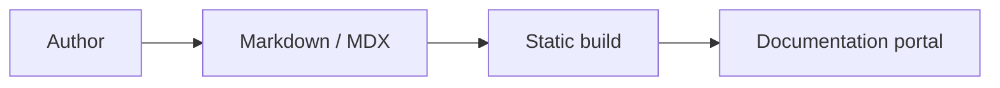

## Mermaid

Use a code block with the `mermaid` language in Markdown or MDX.
Diagrams follow the selected theme. Without JavaScript, the source remains available.

## Changelog

For important documents, maintain a changelog with the date, change, and reason.
